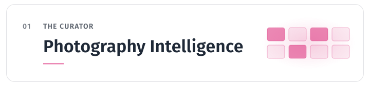
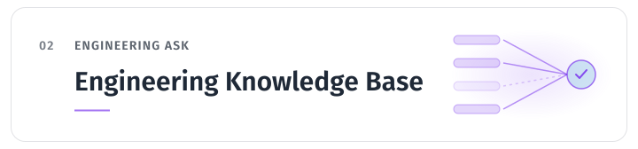

<!-- Generated from the portfolio repository by `bun profile:generate`. Edits made here are overwritten on the next publish. -->

<a href="https://www.vikramrao.me/">
  <picture>
    <source media="(prefers-color-scheme: dark)" srcset="profile-assets/hero-dark.svg">
    
  </picture>
</a>

**Full-stack engineer working across frontend architecture, AI-native products, and accessible interfaces.** Explore verified engineering experience, architecture decisions, technical writing, and grounded answers backed by real project evidence.

[**Visit the portfolio →**](https://www.vikramrao.me/) · [Explore the architecture →](https://www.vikramrao.me/#architecture)

## How it's built.

Systems, technical decisions and the evidence behind them.

<a href="https://www.vikramrao.me/architecture/photography-assistant">
  <picture>
    <source media="(prefers-color-scheme: dark)" srcset="profile-assets/photography-dark.svg">
    
  </picture>
</a>

A grounded AI guide to my photography archive. Describe a mood, a place or a technique; it searches the collection, shows the photographs it found, and answers from what they show and record — and says so when the evidence isn't there.

- Lexical, semantic and filter retrieval run together and a reranker orders the head; a photo found only by meaning must be corroborated by its caption, tags, mood or visual concepts.
- An eight-photo evidence pack bounds what the model sees, and validators gate what it may say.
- Retrieval changes ship only after measurement against a frozen benchmark: 106 questions, 191 photos, 2,460 human relevance judgments.

[Read the architecture →](https://www.vikramrao.me/architecture/photography-assistant) · [Meet the Curator →](https://www.vikramrao.me/photography)

<a href="https://www.vikramrao.me/architecture/engineering-ask">
  <picture>
    <source media="(prefers-color-scheme: dark)" srcset="profile-assets/engineering-kb-dark.svg">
    
  </picture>
</a>

An assistant that answers questions about how I build software from reviewed decision records and approved architecture sections. Answers cite the decisions and architecture articles they draw on, and say so when the evidence is limited.

- Two retrieval paths: a reviewed decision corpus and an independent architecture-evidence index.
- Citation gates drop what the evidence does not hold; a confidence label judges the evidence before the answer is written.
- Measured, not assumed: on a frozen set of 46 questions semantic retrieval beat both BM25 and an RRF hybrid, so the hybrid did not ship.

[Read the architecture →](https://www.vikramrao.me/architecture/engineering-ask) · [Ask it on the homepage →](https://www.vikramrao.me/)

<a href="https://www.vikramrao.me/journal/agent-automation-without-losing-engineering-control">
  <picture>
    <source media="(prefers-color-scheme: dark)" srcset="profile-assets/ai-native-repository-dark.svg">
    
  </picture>
</a>

The repository behind the portfolio is a place an AI agent does real work in — so it is built to keep one line visible: whether the agent acted, or only proposed.

- A static routing manifest — no model in the loop — maps each task to the knowledge concepts and code-graph entry points it needs.
- Architecture boundaries, knowledge links and repository hygiene are validated deterministically at commit, push and in CI.
- Every hook reports or blocks; none fixes, commits or applies a change on its own.

[Read the story →](https://www.vikramrao.me/journal/agent-automation-without-losing-engineering-control) · [How the platform grew →](https://www.vikramrao.me/journal/from-portfolio-to-ai-operable-platform)

## How I work

Each principle links to the write-up where it was earned.

- **Deterministic systems decide; models write.** A deterministic half computes and scores what is true and relevant; only that bounded result reaches the model, whose job is narrowed to prose. [Pipelines Beat Prompts →](https://www.vikramrao.me/journal/pipelines-beat-prompts)
- **Every claim carries its evidence.** Answers cite what they draw on, and the checks behind a citation are deterministic — a badge or a list of IDs is not proof on its own. [Every Match Needs an Explanation →](https://www.vikramrao.me/journal/every-match-needs-an-explanation)
- **Measure before shipping.** Thresholds become measurements against real ground truth, and the gaps no tuning can close are reported, not hidden. [Turning a Threshold Into a Measurement →](https://www.vikramrao.me/journal/turning-a-threshold-into-a-measurement)
- **Build the whole path.** Retrieval, evidence construction, the generation contract, validators, the answer UI and the evaluation tooling — designed as one system, not bolted-on features. [Photography Assistant Architecture →](https://www.vikramrao.me/architecture/photography-assistant)
- **Agents work inside guardrails.** AI-assisted development with machine-checked boundaries, so speed never costs the ability to tell what changed and why. [Agent Automation Without Losing Engineering Control →](https://www.vikramrao.me/journal/agent-automation-without-losing-engineering-control)

<a href="https://www.vikramrao.me/">
  <picture>
    <source media="(prefers-color-scheme: dark)" srcset="profile-assets/closing-dark.svg">
    
  </picture>
</a>

Architecture write-ups, the decisions behind them, the experiments that failed, and the interactive systems themselves — the Curator and Engineering Ask both run live on the site.

[**Visit the portfolio →**](https://www.vikramrao.me/) · [Read the engineering journal →](https://www.vikramrao.me/journal)

This profile is generated from the same repository as vikramrao.me.
